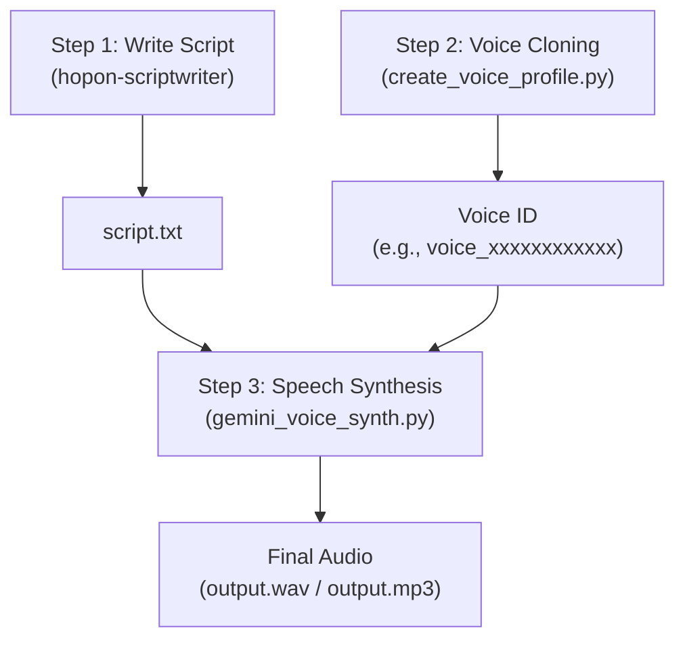

# Hop On Voice and Script

Tools, skills, and synthesis pipelines for Debarshi's **Hop On** travel documentaries.

## Contents

### 1. `scripts/`
- **`create_voice_profile.py`**: Registers a persistent replicated voice profile using `google-genai` SDK and Gemini 3.8 Flash TTS. Takes reference and consent WAV audio files and outputs a persistent `voice_id` (stored for 1 year with automatic renewal on use).
- **`gemini_voice_synth.py`**: CLI synthesis tool with paragraph chunking, speech metadata style anchoring, non-conflicting auto-numbering file exports, and direct WAV stitching.

### 2. `.agents/skills/` (Antigravity Auto-Discovery)
- **`hopon-scriptwriter`**: Authentically crafts spoken voiceover scripts in Debarshi's signature Kolkata Banglish style (pure spoken narration text, zero visual/production tags).

> **Note**: Placed inside `.agents/skills/` so `agy` (Google Antigravity) automatically discovers and registers it when opening this repository.

## End-to-End Workflow



---

### Step 1: Scriptwriting via `hopon-scriptwriter` Skill

1. **Activate the Skill**:
   - In Antigravity (`agy`), simply ask:
     > *"Write a voiceover script for my upcoming Switzerland travel vlog about Zermatt and the Matterhorn."*
   - Antigravity automatically detects and activates `.agents/skills/hopon-scriptwriter`.

2. **Save Output**:
   - Save the approved script to a text file (e.g., `script.txt`).

---

### Step 2: One-Time Voice Profile Creation

You only need to run this **once per year** (Google renews the 1-year expiration automatically every time you synthesize audio).

1. **Prepare Audio Samples** (24kHz Mono 16-bit WAV):
   - **Reference Audio (`reference.wav`)**: Exactly 10–30 seconds of clean, natural conversational speech.
   - **Consent Statement (`consent.wav`)**: The same speaker reading Google's mandatory legal statement:
     > *"I am the owner of this voice and I consent to Google using this voice to create a synthetic voice model."*

2. **Register Profile**:
   ```bash
   python3 scripts/create_voice_profile.py \
     --reference reference.wav \
     --consent consent.wav \
     --display-name "Debarshi Voice Profile"
   ```

3. **Output**:
   - Google validates biometric identity matching between the two clips, stores the profile, and returns your persistent **`Voice ID`** (e.g., `voice_xxxxxxxxxxxx`).
   - You can now archive or delete the WAV files; you only need the `Voice ID` going forward.

---

### Step 3: Generating Voiceover Audio for Your Script

1. **Run Synthesis Pipeline**:
   ```bash
   python3 scripts/gemini_voice_synth.py \
     --voice-id "voice_xxxxxxxxxxxx" \
     --file path/to/script.txt \
     --output path/to/narration.wav
   ```

2. **What the Script Handles Under the Hood**:
   - **Paragraph Chunking**: Splits longer scripts into discrete 10–15 second paragraph units to prevent acoustic latent drift.
   - **Acoustic Style Anchoring**: Attaches `speech_metadata.style` to ensure Google's multilingual model retains your natural British-Indian/Bengali cadence and avoids falling into an American twang.
   - **Seamless Concatenation**: Assembles every synthesized chunk with a natural 350ms pause into a single audio file.
   - **Non-Destructive Auto-Numbering**: If `narration.wav` already exists, it automatically increments to `narration_1.wav`, `narration_2.wav`, preventing accidental overwrites.
